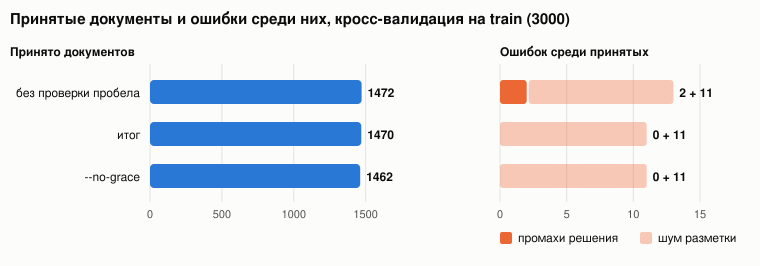
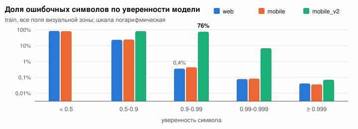

# Отчет. Постобработка OCR паспорта РФ

## Прогноз на test

Из 2000 документов test принимаю **1008**. Ожидаю среди них **около 8 с ошибкой** (с вероятностью около 90% от 4 до 13). Почти все они придутся на шум разметки (подробно ниже). Если разметка test чистая, ошибок будет 0-2.

Для сравнения, если принять все документы как есть, ошибка будет в 46% из них (1376 из 3000 на train). Оценка взята из 5-кратной кросс-валидации на train, словари строятся без проверяемого фолда. Принято 1470 из 3000 (49,0%), ошибок 11 (0,75% принятых), и все 11 оказались шумом разметки. Последнее правило (проверка пробела после сокращения) я подобрала по двум промахам train, поэтому закладываю на test еще около одного промаха. На других разбиениях от 1460 до 1474 принятых и 10-11 ошибок. Доля принятых по источникам близкая (web 47,7%, mobile 50,5%, mobile_v2 51,0%), так что вдвое большая доля mobile_v2 в test прогноз почти не сдвигает.

## Как устроено решение

Опорная идея в том, что у паспорта есть второй, независимый источник данных, MRZ. В ней продублированы ФИО, дата рождения, пол, серия и номер, дата выдачи и код подразделения, а у номера, даты рождения и блока с датой выдачи и кодом есть контрольные цифры. Уверенности модели самой по себе верить нельзя, она ошибается и при уверенности 1.0 («ТАДЖИАХМЕДОВА» вместо «ГАДЖИАХМЕДОВА»).

1. **Поля MRZ.** Если контрольные цифры поля и итоговая цифра сходятся, беру значение из MRZ, даже если визуальная зона прочитана иначе. На train так взято 10467 значений в 2618 документах, неверных нет, хотя в 352 случаях визуальная зона с ними расходится. Сломанную строку MRZ чиню одной правкой, если вариант единственный, сходятся все контрольные цифры и нет противоречий с визуальной зоной (без этой сверки 109 строк чинятся верно и 1 неверно, со сверкой 123 и ни одной ошибки). Без MRZ визуальная зона ошибается в 0,5-1,4% полей даже при уверенности всех символов выше 0.99, такие документы отклоняю.
2. **ФИО.** Собираю из визуальной зоны ожидаемую строку 1 MRZ (у МВД своя обратимая транслитерация, Ч→3, Й→Q, Ь→9 и так далее) и сравниваю с прочитанной. Если они расходятся в одном месте, выбираю чтение, которое уверено (≥0.99), когда второе явно не уверено (<0.9). На train правило сработало 157 раз и всегда верно. Для mobile_v2 расхождения не разрешаю. Пол сверяю с MRZ, а без нее с окончанием отчества.
3. **Место рождения и орган выдачи.** Второго источника нет, работаю по словарю из разметки train и справочника подразделений.
   - Известное слово принимаю при уверенности символов от 0.9. Незнакомое (обычно название села) только при высокой уверенности и если оно не отличается одной правкой от частого слова, иначе это почти всегда опечатка вроде «ВОССИИ».
   - Опечатку исправляю, если в словаре ровно один частый кандидат на расстоянии одной правки и правка приходится на неуверенный символ. На CV 232 исправления, все верные.
   - Пропущенную строку ловлю по пустому зазору в рамке поля больше половины высоты строки. На train так отмечено 73 поля, во всех строка действительно потеряна, других потерь нет.
4. **Действительность.** По п. 24 Положения о паспорте паспорт действует с 14 до 20 лет, с 20 до 45 и с 45 бессрочно, а после 20 и 45 лет старый паспорт действует до замены, но не более 90 календарных дней. Так и проверяю на 01.10.2026. Окно заложено и в данные (в train 15 паспортов просрочены по возрасту меньше чем на 90 дней, дальше примерно один в 100 дней). В test окно дает 8 принятых. Если проверка их не засчитает, флаг `--no-grace` их отклоняет (тогда принято 1000).

## Что выяснила по данным

- **У mobile_v2 уверенность не откалибрована.** У символов с уверенностью от 0.9 до 0.99 ошибок 76%, у web и mobile 0,4%, поэтому для mobile_v2 пороги строже (0.9999 вместо 0.99 для незнакомых слов).

- **Потерянную точку видно по соседним символам.** Модель часто теряет точку в «ОБЛ.», «ПГТ.», «Г.». Удаленного символа в выводе нет, но рядом падает уверенность. Обычно у последней буквы (у «Л» в «ОБЛ» медиана 0.72 вместо 0.999), а если буква осталась уверенной, то у пробела после слова (0.59-0.73, после тех же сокращений без точки в разметке не ниже 0.80). Если сокращение в разметке всегда с точкой, точку восстанавливаю, если бывает по-разному, требую уверенности и у буквы, и у двух следующих символов. Проверка пробела убрала оба оставшихся промаха CV ценой 2 принятых документов.
- **В разметке есть шум.** В 11 документах из 2292, где визуальная зона и MRZ дают одно и то же ФИО, в разметке стоит другое («ЬАЛТРУШЕЕВИЧ», «ФАРИЛА», «ЗИЯНУРСВ»). Это опечатки с типичными для OCR заменами, и то же есть в месте рождения (аул Джамбичи в Адыгее записан как «ДЖАМБИУИ»). Из данных их не отличить, они остаются в прогнозе.

**Что можно улучшить.** Главный резерв в месте рождения. Оно есть в 631 отказе из 992 на test, и в 304 это единственная причина. Названия сел почти не встречаются в словаре, и справочник населенных пунктов (ФИАС или ОКТМО) позволил бы проверять их и исправлять опечатки. Второй резерв в 5% документов test без MRZ.
